<div align="center">




<br/>


</div>

**A read-only server incident report built for AI agents.**

When a server breaks, agents can't see inside it. Logs are huge and
scattered, dashboards are drawn for human eyes, and a person ends up
copying fragments to the agent by hand.

`triage collect` reads the machine once and writes **one compact
markdown report** — system, services, ports, and errors deduplicated
by signature with counts — that any agent (Cursor, Claude Code,
OpenClaw, Ko Pai, …) can read in a single pass.




## 🛡️ Guarantees

- **Read-only.** Never starts, stops, restarts, edits, or deletes anything.
- **Secrets redacted** before they reach the report: passwords, tokens,
  API keys, `Authorization` headers, connection-string passwords, JWTs,
  GitHub/Slack/cloud key shapes.
- **Zero dependencies.** Python 3 standard library only. No pip installs,
  no API keys, no network calls.
- **Graceful.** A missing source (no systemd, no nginx log) is reported
  as `unavailable`, never as a crash.


## 🚀 Quick start

```bash
python3 triage.py collect                 # report to stdout
python3 triage.py collect --hours 48 --out report.md
```

<div align="center">

</div>

Example summary from a real run:

> `myhost at 2026-10-23 02:07 UTC: 0 failed service(s), 16 listening port(s), fullest disk at 42%, 606 unique error signature(s) in the last 24h. Most frequent error: ×232 …failed-to-find-server-action.`

1,277 raw error lines across 33 log sources became one 50-line report.


## 📋 Report sections

| # | Section | What it tells the agent |
|---|---------|-------------------------|
| 1 | **System** | host, OS, uptime, load, memory, disk, top processes |
| 2 | **Services** | systemd state, failed units, running count |
| 3 | **Ports** | listening TCP ports — spot conflicts fast |
| 4 | **Errors** | journal (err+) + nginx/apache/syslog/PM2 logs, normalised, **deduplicated with counts**, top 20 |
| 5 | **Summary** | one paragraph an agent can act on immediately |


## 🤖 Use it from an agent

**MCP (stdio)** — one tool, `triage_collect`:

```bash
python3 triage.py mcp
```

```json
{ "command": "python3", "args": ["/path/to/triage.py", "mcp"] }
```

**Skill** — see [SKILL.md](SKILL.md): *when a site is down, run triage
first, before reading raw logs or changing anything.*

## ✅ Tests

```bash
python3 -m unittest   # redaction, signature dedupe, report structure
```

9 tests, including a planted-secret end-to-end check: fake passwords
planted in a log file come out as `[REDACTED]`, and 12 repeated error
lines collapse into a single `×12` signature.


## 🗺️ Roadmap

- v0.2: time-bound PM2 log reading, traceback grouping, noise filters
  (e.g. firewall block spam), `--json` output
- Later: fleet mode (many servers, one report), pre/post-deploy diff,
  alert hooks that send the report to Telegram

## 📄 License

MIT — see [LICENSE](LICENSE).


